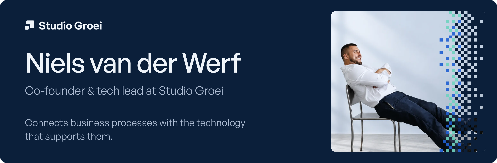
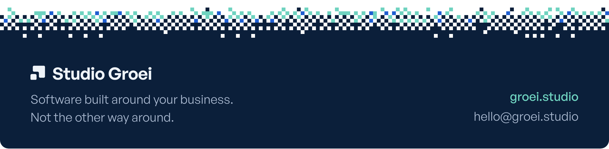

 

Hi, I'm Niels, co-founder and tech lead at [Studio Groei](https://groei.studio/en). We build software around your business, not the other way around.

I started in retail and sales, as a sales adviser, department manager and account manager, and then moved into enterprise IT. I know the responsibility for revenue and the frustration of a system that does not do what you need. Since 2023 I have been building my own production systems: multi-agent orchestration, RAG applications and integrations. My focus is what an organisation can do with them every day.

### How I work

I start with the process. Which systems do you already use? Where is information copied across? What happens with an exception? The answers determine what needs building and connecting.

At Studio Groei we also use our own software for the client portal, quotes and payments. Daily use keeps the technology close to the work it supports.

### What I work with

  
  
  
  
  
  
  
  
  

### Selected work

| Project | What it is |
| --- | --- |
| [Serac](https://serac.build) · [source](https://github.com/serac-labs/serac) | AI support within the ServiceNow workflow: a ServiceNow MCP server and the skill guides that teach an agent to use it |
| [Studio Groei](https://groei.studio/en/projects/studio-groei) | The platform where clients follow their project and sign off each phase |
| [Snelnotuleren](https://groei.studio/en/projects/snelnotuleren) | Audio into meeting minutes, with AI (2024–2025) |
| [groeimetai-platform](https://github.com/groeimetai/groeimetai-platform) | Platform engineering and scalable execution systems |
| [groeimetai-website](https://github.com/groeimetai/groeimetai-website) | Brand-led frontend and digital product presence |

More of what we build at Studio Groei: [groei.studio/en/projects](https://groei.studio/en/projects).

### On GitHub

  <picture>
    <source media="(prefers-color-scheme: dark)" srcset="https://github-readme-stats.vercel.app/api?username=groeimetai&show_icons=true&hide_border=true&bg_color=00000000&title_color=EEF3F9&icon_color=6FD3C0&text_color=A9B8CF">
    
  </picture>
  <picture>
    <source media="(prefers-color-scheme: dark)" srcset="https://github-readme-stats.vercel.app/api/top-langs/?username=groeimetai&layout=compact&hide_border=true&bg_color=00000000&title_color=EEF3F9&text_color=A9B8CF">
    
  </picture>

### Links

  
  
  

 

